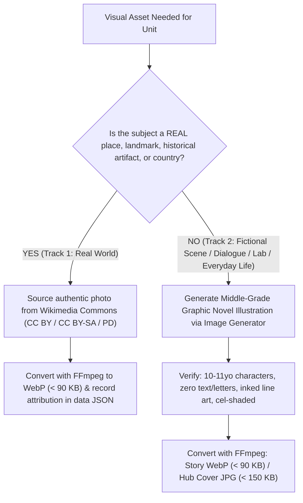

# Retro Comic & Bio-Warm 2026: Complete Design & Engineering Specification
**Target Implementation:** 5th Grade English Digital Coursebook & Vocabulary Companion (*Αγγλικά Ε' Δημοτικού*, Ages 10–11, CEFR A1 / A1+)  
**Reference Implementation:** 6th Grade English (*ΣΤ' Δημοτικού*) — `vocabulary-st-modern/` (Hub, Unit 1, Unit 2)  
**Compliance Standard:** 100% Offline-First (`file://` & static web ready), Zero External Network Calls (GDPR / Pupil Privacy), Dual-Edition Parallel Tree

---

## 1. Executive Vision & Pedagogical Philosophy

### 1.1 Core Thesis
> **"The site IS the coursebook. The Companion is the vocabulary layer."**

Traditional digital school supplements fail 10-to-11-year-old learners (5th & 6th Grade) in two ways:
1. **Infantilization ("Toddler Tropes"):** Generic primary-school web apps use clip-art cartoons, pastel baby colors, and oversized Fisher-Price buttons that alienate pre-teens (ages 10–11) who consume middle-grade graphic novels (*Amulet*, *Raina Telgemeier*, *Dog Man*, *InvestiGators*), anime, and modern gaming UIs.
2. **Sterile SaaS Corporate UI:** Standard Bootstrap/Tailwind dashboards feel like adult spreadsheets rather than an inviting storybook or activity magazine.

**Retro Comic & Bio-Warm 2026** solves both problems by combining **tactile print-comic physicality** (warm cream paper, chunky `#0F172A` ink borders, hard offset drop shadows, expressive cel-shaded illustrations) with **rigorous ELT pedagogy** (bilingual English-Greek lexical tables, CEFR-graded definitions, dual-voice offline neural audio, and scaffolded writing/grammar labs).

### 1.2 Target Audience Profile (5th Grade / Ε' Δημοτικού)
- **Age Group:** 10–11 years old (pre-adolescent / middle-grade).
- **CEFR Level:** A1 transitioning to A1+.
- **Visual Expectations:** Characters in cool, contemporary casual clothes (hoodies, graphic tees, sneakers, backpacks, headphones) with relatable expressions and dynamic camera angles.
- **Classroom Hardware Reality:** Interactive Whiteboards (IWBs), 1366×768 school laptops, tablets, and offline school computer labs with unreliable internet.

---

## 2. Parallel-Tree Directory Architecture

To modernize a coursebook without breaking legacy links, existing bookmarks, or classic views, the **Retro Comic & Bio-Warm 2026** edition lives in a **parallel directory tree** (`vocabulary-5th-modern/` or `vocabulary-st-modern/`) that **shares data and audio/image assets** with the classic `unitN/` directories.

### 2.1 Repository File Tree
```text
project-root/
├── portal.html                        # Classic Master Portal
├── assets/
│   └── fonts/
│       ├── fonts.css                  # 100% Local @font-face declarations (WOFF2)
│       └── *.woff2                    # Bricolage Grotesque, Inter, JetBrains Mono, Outfit
├── unit1/                             # Classic Unit 1 Directory (Single Source of Truth for Data/Audio)
│   ├── index.html                     # Classic Vocabulary Companion (includes switcher to Comic Companion)
│   ├── v2.html                        # Classic Coursebook Companion (includes switcher to Comic Edition)
│   ├── style.css                      # Base Companion layout stylesheet
│   ├── style_v2.css                   # Base Coursebook layout stylesheet
│   ├── data/
│   │   ├── vocabulary_data.json       # Canonical Vocabulary JSON
│   │   ├── vocabulary_data.js         # Offline JS Twin: window.VOCABULARY_DATA = [...]
│   │   ├── unit1_v2_data.json         # Canonical Coursebook JSON (stories, grammar, collocations, writing)
│   │   ├── unit1_v2_data.js           # Offline JS Twin: window.UNIT1_V2_DATA = {...}
│   │   ├── unit1_workbook_data.json   # Canonical Workbook JSON
│   │   └── unit1_workbook_data.js     # Offline JS Twin: window.UNIT1_WORKBOOK_DATA = {...}
│   └── assets/
│       ├── audio/                     # Classic TTS MP3s (words/, defs/, examples/)
│       ├── audio_neural/              # Edge Neural "Sonia" MP3s (words/, defs/, examples/)
│       ├── audio_v2/                  # Story & Grammar Lab dialogue MP3s (stories/, grammar/, workbook/)
│       ├── images/                    # Vocabulary item visual glosses (SVG / WebP)
│       └── images_v2/                 # Story & Grammar Lab illustrations (.webp, < 90 KB)
│
└── vocabulary-st-modern/              # (Name `vocabulary-5th-modern` for 5th Grade)
    ├── index.html                     # Graphic Novel Hub (Split-Book Cards for all Units)
    ├── style.css                      # Master Bio-Warm 2026 Design System & Hub Styles
    ├── script.js                      # Hub interactive term filtering, search, & audio preview
    ├── imgs/                          # Hub featured unit covers (.jpg < 150 KB) & story thumbs (.webp < 90 KB)
    │   ├── hero_illustration.jpg
    │   ├── unit1_featured.jpg
    │   └── unit2_featured.jpg
    ├── unit1/
    │   ├── index.html                 # Modern Comic Coursebook (identical copy of coursebook.html)
    │   ├── coursebook.html            # Modern Comic Coursebook
    │   ├── companion.html             # Modern Comic 6-Mode Vocabulary Companion
    │   ├── unit1_comic.css            # Unit Theme Adaptor (Bio-Warm tokens + Compact Header overrides)
    │   ├── app_v2.js                  # Coursebook Engine (with resolveAsset() -> ../../unit1/assets/*)
    │   ├── app_companion.js           # Companion Engine (with resolveAsset() -> ../../unit1/assets/*)
    │   └── test_modern_u1.js          # Automated Node.js Verification Suite
    └── unit2/
        ├── index.html
        ├── coursebook.html
        ├── companion.html
        ├── unit2_comic.css
        ├── app_v2.js
        ├── app_companion.js
        └── test_modern_u2.js
```

### 2.2 Stylesheet Cascade Order
Every modernized unit page (`coursebook.html` and `companion.html`) layers CSS in four deterministic steps:
```html
<!-- 1. Local Offline Fonts -->
<link rel="stylesheet" href="../../assets/fonts/fonts.css">
<!-- 2. Classic Structural Layout (style_v2.css for coursebook OR style.css for companion) -->
<link rel="stylesheet" href="../../unit1/style_v2.css">
<!-- 3. Bio-Warm 2026 Master Design Tokens -->
<link rel="stylesheet" href="../style.css">
<!-- 4. Unit Comic Theme Adaptor & Compact Header Overrides -->
<link rel="stylesheet" href="unit1_comic.css">
```

---

## 3. Bio-Warm 2026 Design Tokens & Visual Language

### 3.1 Color Palette (`:root` CSS Custom Properties)
Copy this exact `:root` token block into both the root `style.css` and each `unitN_comic.css`:

```css
:root {
  /* === Primary Bio-Warm 2026 Palette === */
  --ink:          #0F172A;   /* Deep Comic Ink — all borders, hard shadows, primary headings */
  --ink-soft:     #475569;   /* Slate — secondary body copy, definitions */
  --ink-muted:    #94A3B8;   /* Muted Slate — IPA transcriptions, metadata, captions */
  --snow:         #FFFFFF;   /* Crisp White — card surfaces, active containers */
  --cream:        #FFF8E8;   /* Warm Parchment — page background, narrative boxes, table headers */

  /* === Expressive Accent Colors === */
  --coral:        #FF6B47;   /* Primary Action Accent — active tabs, CTAs, Greek meanings */
  --coral-deep:   #E84F2E;   /* Hover state & hard shadow for coral buttons */
  --coral-tint:   #FFE2D7;   /* Soft coral badge fill & highlight background */

  --lime:         #B6E528;   /* Secondary Accent — active story/country pills, success states */
  --lime-deep:    #8FB81E;   /* Deep lime border/text accent */
  --lime-tint:    #EEF9C9;   /* Core syllabus pill background & card hover tint */

  --gold:         #FFC800;   /* Highlight Accent — stars, streaks, CLIL badges */
  --gold-deep:    #D9A800;   /* Deep gold border accent */
  --gold-tint:    #FFF4C2;   /* Button hover background & timeline callouts */

  --hot-pink:     #FF5C99;   /* Playful decorative accent */
  --sky:          #3DA9FC;   /* Dual/Info badge accent */
  --sky-tint:     #D9EFFE;   /* Info callout fill */

  /* === Legacy Variable Bridge (Automatically reskins classic components) === */
  --primary:          var(--coral);
  --primary-color:    var(--coral);
  --primary-hover:    var(--coral-deep);
  --primary-light:    var(--coral-tint);
  --primary-border:   var(--coral);
  --secondary:        var(--lime);
  --secondary-color:  var(--lime-deep);
  --secondary-light:  var(--lime-tint);
  --accent-gold:      var(--gold);
  --accent-green:     var(--lime-deep);
  --accent-blue:      var(--sky);
  --bg-page:          var(--cream);
  --bg-card:          var(--snow);
  --text-dark:        var(--ink);
  --text-medium:      var(--ink-soft);
  --text-light:       var(--ink-muted);
  --border-table:     var(--ink);
  --border-subtle:    var(--ink);
  --border-warm:      var(--gold);
  --border-focus:     var(--coral);

  /* === Tactile Comic Ink Shadows (Zero Blur!) === */
  --shadow-sm:    0 3px 0 0 var(--ink);
  --shadow-md:    0 4px 0 0 var(--ink);
  --shadow-lg:    0 6px 0 0 var(--ink);
  --shadow-coral: 0 4px 0 0 var(--coral-deep);

  /* === Border Radii === */
  --radius-xs:    6px;
  --radius-sm:    10px;
  --radius-md:    16px;
  --radius-lg:    24px;
  --radius-xl:    32px;
  --radius-full:  9999px;

  /* === Motion Curves === */
  --ease-spring:  cubic-bezier(0.34, 1.56, 0.64, 1);
  --ease-out:     cubic-bezier(0.4, 0.0, 0.2, 1);
  --max:          1280px;
}
```

### 3.2 Typography System
All fonts must be served locally from `assets/fonts/` with zero Google Fonts CDN calls:

| Role | Font Family | Weights | CSS Target Selectors |
| :--- | :--- | :--- | :--- |
| **Display & Headings** | `'Bricolage Grotesque', sans-serif` | `700`, `800` | `h1, h2, h3, h4, .main-title, .panel-title, .v2-tab, .word-meaning, .stat-num` |
| **Body & Reading Copy** | `'Inter', -apple-system, sans-serif` | `400`, `600`, `700` | `body, p, .story-narrative-box, .word-term, .word-def, input, select` |
| **Technical Tags & Badges** | `'JetBrains Mono', monospace` | `500`, `700`, `800` | `.badge, .syllabus-pill, .tab-badge-pill, .quick-quiz-pill, .hud-label, th` |

### 3.3 Tactile "Comic Panel" Physics
1. **Zero-Blur Hard Shadows:** Never use soft Gaussian shadows (`0 10px 25px rgba(0,0,0,0.1)`). Always use solid, zero-blur vertical ink offsets (`box-shadow: 0 4px 0 0 var(--ink)`).
2. **Chunky Ink Outlines:**
   - Primary containers (`.story-dossier-card`, `.vocab-table-container`, `.vocab-flashcard`, `.audio-hud`): `border: 3px solid var(--ink)` + `box-shadow: 0 6px 0 0 var(--ink)`.
   - Secondary cards (`.panel-header-box`, `.grammar-card`, `.wb-card`): `border: 2.5px solid var(--ink)` + `box-shadow: 0 4px 0 0 var(--ink)`.
   - Interactive pills, tabs, and buttons (`.v2-tab`, `.mode-btn`, `.pill-btn`, `.hub-link`): `border: 1.5px solid var(--ink)` + `box-shadow: 0 2px 0 0 var(--ink)`.
3. **Interactive Press & Hover Mechanics:**
   - **Hover:** `transform: translateY(-1px)` (or `-2px` on large CTAs), shadow grows by `+1px` (`0 3px 0 0 var(--ink)`), background shifts to `var(--gold-tint)` or `var(--lime-tint)`.
   - **Active State:** Background fills with `var(--coral)`, text becomes `var(--snow)`, shadow shifts to `var(--coral-deep)`.

---

## 4. Compact Single-Screen Header Specification (Critical UX Rule)

### 4.1 The Viewport Problem & Solution
On 1366×768 classroom laptops, a sticky or tall multi-row header consumes 45–60% of the vertical screen height, forcing students to scroll just to see the first vocabulary word or story paragraph.

**Mandatory Header Rules:**
1. **`position: relative !important`** — The header scrolls naturally with the page (`top: auto !important`), freeing 100% of the viewport once the student begins reading or working.
2. **Ultra-Compact Vertical Padding** — Total header height must stay under `~165px` so the first 5–6 vocabulary rows or the full Story Dossier hero are immediately visible above the fold.

### 4.2 Four-Row Compact Header Anatomy
```text
┌────────────────────────────────────────────────────────────────────────────────────────┐
│ [🎯 Quick Quizzes:] (Unit 1) (Unit 2) (Unit 3) ... (Unit 10)     [4px top/bottom pad]  │
├────────────────────────────────────────────────────────────────────────────────────────┤
│ Row 1: [🎨 Comic Hub] [🏠 Portal] [🇬🇷 5th Grade] [CEFR A1]   [🏛️ Classic] [📙 Coursebook]│
│ ---------------------------------------------------------------- (1.5px dashed divider)│
│ Row 2: Unit Title (1.45rem) + Subtitle inline     [35 LEXICAL ITEMS] [280 MP3s] / Voice│
│ Row 3: [📋 Table] [🗂️ Cards] [🎯 Listening] [💡 Def] [🖨️ Print]  [🔍 Search] [Voice/Spd]│
│ Row 4: (All Words) (Category 1) (Category 2) ... -> horizontal single-line scroll      │
└────────────────────────────────────────────────────────────────────────────────────────┘
```

### 4.3 Exact CSS Implementation for Compact Header
Include these rules in `unitN_comic.css`:
```css
.app-header, .main-header {
  position: relative !important;
  top: auto !important;
  background: var(--snow) !important;
  border-bottom: 2.5px solid var(--ink) !important;
  box-shadow: 0 3px 0 0 var(--ink) !important;
  padding: 6px 0 8px !important;
  margin-bottom: 14px !important;
}

.header-container {
  max-width: 1280px;
  margin: 0 auto;
  padding: 4px 20px !important;
}

/* Title & Subtitle inline on the same baseline */
.header-hero, .header-title-row {
  display: flex;
  justify-content: space-between;
  align-items: center !important;
  flex-wrap: wrap;
  gap: 10px !important;
  padding: 2px 0 6px !important;
  margin-bottom: 4px !important;
}

.title-wrap, .hero-text-wrap {
  display: flex;
  align-items: baseline;
  gap: 10px;
  flex-wrap: wrap;
}

.main-title {
  font-size: clamp(1.3rem, 2.2vw, 1.6rem) !important;
  line-height: 1.1;
  margin: 0 !important;
}

.sub-title {
  font-size: 0.82rem !important;
  margin: 0 !important;
}

/* Inline Pill Stat Badges (replaces tall stacked stat boxes) */
.stat-card {
  display: inline-flex !important;
  align-items: baseline;
  gap: 5px;
  background: var(--cream) !important;
  border: 1.5px solid var(--ink) !important;
  border-radius: 9999px !important;
  padding: 3px 10px !important;
  box-shadow: 0 2px 0 0 var(--ink) !important;
}

/* Single-Line Horizontal Category Scroller */
.category-pills {
  display: flex !important;
  flex-wrap: nowrap !important;
  overflow-x: auto !important;
  gap: 5px !important;
  margin-top: 2px !important;
  padding: 2px 0 4px !important;
  scrollbar-width: thin;
}
```

---

## 5. The Two-Track Visual System & Prompt Engineering Contract

Every visual in the modernized coursebook follows a strict pedagogical split between **Real-World Documentary Photography** and **Middle-Grade Graphic Novel Illustration**.



### 5.1 Track 1: Real-World Photography (Countries, Landmarks, History, Geography)
- **When to Use:** Real countries (e.g., Ukraine, UK, France, Greece), real rivers/mountains, museums, historical monuments, or real scientific artifacts.
- **Source:** Open-source Wikimedia Commons (`CC BY`, `CC BY-SA`, or `Public Domain`).
- **Metadata Requirement:** Every real photo must store `image_source: "wikimedia"` and exact license/author credits in `unitN_v2_data.json` and render a `.story-media-caption` badge.

### 5.2 Track 2: Middle-Grade Graphic Novel Illustrations (Fictional Characters & Scenes)
- **When to Use:** Classroom scenes, computer labs, shopping trips, family dialogues, pen-pal stories, comic strips (e.g., *Mr Badluck*), and unit cover art.
- **Prompt Engineering Contract (Copy-Paste Template for 5th Grade):**

```text
PROMPT TEMPLATE:
Middle-grade graphic novel style illustration of [SCENE DESCRIPTION, e.g., an elementary school science lab / a busy neighborhood bakery / two kids building a treehouse]. 10-11 year old students in cool contemporary casual clothes (hoodies, graphic t-shirts, denim jackets, sneakers) [ACTION & EXPRESSION]. Expressive inked line art with varied line weight, vibrant cel-shaded Bio-Warm color palette (warm cream, coral orange, golden yellow, deep slate ink shadows), dynamic perspective, contemporary teen/pre-teen comic book aesthetic (Raina Telgemeier / Amulet style). Strictly no toddler tropes, no babyish proportions. Pure visual storytelling: strictly no text, no letters, no numbers, no signage, no speech bubbles, no price tags, no written words anywhere in the image.
```

- **Mandatory Quality Gates for Generated Images:**
  1. **Zero Text Rule:** AI generators often hallucinate garbled English/Greek letters on chalkboards, store signs, computer screens, or book covers. Prompt explicitly for *blank/abstract geometric shapes* on screens/boards and inspect every generated image to confirm zero text.
  2. **Age-Appropriate Proportions:** Characters must look 10–11 years old (5th/6th grade proportions), never 5-year-old toddlers.

### 5.3 FFmpeg Optimization Pipeline & Byte Budgets
Never commit raw multi-megabyte PNG/JPG files. Run these exact `ffmpeg` commands:

1. **Story & Module Illustrations (`assets/images_v2/*.webp` & `vocabulary-5th-modern/imgs/*.webp` — Budget: `< 90 KB`):**
   ```powershell
   ffmpeg -y -i raw_scene.jpg -vf "scale=720:-2" -c:v libwebp -quality 52 output_scene.webp
   ```
2. **Hub Featured Unit Cover (`vocabulary-5th-modern/imgs/unitN_featured.jpg` — Budget: `< 150 KB`):**
   ```powershell
   ffmpeg -y -i raw_cover.jpg -vf "scale=720:-2" -q:v 5 unitN_featured.jpg
   ```

---

## 6. Component-by-Component UI & DOM Blueprint

### 6.1 The Graphic Novel Hub (`vocabulary-5th-modern/index.html`)
The Hub presents the entire 10-unit syllabus as interactive **Open Spreads** (`.unit-split`):
- **Left Page (`.unit-side.v1-side` — Coursebook Layer):**
  - Displays `.side-tag.v1` ("Coursebook") + unit number (`Unit 01 · Interactive Lesson`).
  - Featured Units include `.v1-cover` (`imgs/unitN_featured.jpg`) and a thumbnail strip (`.unit1-real-strip`) showcasing 3–4 story vignettes or real-world photos from that unit.
  - Action buttons: Primary `Open Comic Coursebook` (`unitN/index.html`) + Secondary `Classic Edition 🏛️` (`../unitN/v2.html`).
- **Center Spine (`.unit-fold`):** Visual book crease with `.fold-mark`.
- **Right Page (`.unit-side.v2-side` — Companion Layer):**
  - Displays `.side-tag.v2` ("Companion") + `Vocabulary Layer λεξιλόγιο`.
  - Shows a 6-word preview `.vocab-table` (`English word ↔ Greek meaning`).
  - Action buttons: Primary `Open Vocabulary Companion` (`unitN/companion.html`) + Secondary `Classic Companion 🏛️` (`../unitN/index.html`).

### 6.2 Interactive Coursebook (`unitN/coursebook.html` & `unitN/index.html`)
Use the **Dynamic Modular Shell Architecture** (established in Unit 2). The HTML file stays a clean ~120-line shell where `#moduleTabs` and `#v2Panels` are populated from `window.UNIT{N}_V2_DATA` and `window.UNIT{N}_WORKBOOK_DATA`:

```html
<body data-unit="1" data-workbook="unit1_workbook_data.js">
  <!-- Ambient Orbs + Floating #audioHud -->
  <header class="app-header no-print">
    <!-- Row 1: Breadcrumbs + Switchers (Classic Edition, Teacher Notes, Vocabulary Companion, Print Pack) -->
    <!-- Row 2: Unit Title + Subtitle + AI Voice/Speed Selectors -->
    <nav class="v2-nav-tabs" id="moduleTabs" role="tablist" aria-label="Learning modules"></nav>
  </header>

  <main class="main-content">
    <div class="content-container" id="v2Panels"></div>
  </main>

  <div id="workbookPrintArea" class="workbook-print-area no-screen" style="display:none;"></div>

  <script src="../../unit1/data/vocabulary_data.js"></script>
  <script src="../../unit1/data/unit1_v2_data.js"></script>
  <script src="../../unit1/data/unit1_workbook_data.js"></script>
  <script src="app_v2.js"></script>
</body>
```

**Standard Coursebook Modules Generated by `app_v2.js`:**
1. `📚 Reading Dossiers` (`stories`) — Story selector pills, 2-column hero card with graphic novel art/photo, full-story audio player, highlighted target vocabulary in text, and key item cards.
2. `🧪 Grammar Lab` (`grammar`) — Rule discovery boxes, interactive timelines/tables, authentic listening tasks with transcript toggles, and self-check quizzes.
3. `🧩 Words in Partnership` (`collocations`) — Collocation matching chips and Definition Clue Challenge.
4. `✍️ Writing Workshop` (`writing`) — Scaffolded paragraph-by-paragraph guided writing builder with live preview and print export.
5. `🎧 Practice Arena` (`practice`) — True/False comprehension checklists and audio vocabulary challenges.
6. `🖨️ Printable Worksheets` (`worksheets`) — Classroom-ready A4 printable worksheet pack.
7. `🎖️ Can-Do Passport` (`passport`) — CEFR self-assessment checklist and printable achievement certificate.
8. `📓 Workbook` (`workbook`) — All printed Workbook exercises in book order with instant answer verification.
9. `🧑‍🏫 Teacher Notes` (`notes`) — Pedagogical guidance, source discrepancy resolutions, and fact checks.

### 6.3 Bilingual Vocabulary Companion (`unitN/companion.html`)
Provides 6 specialized learning views switched via `.view-modes`:
1. **`#viewTable` (Table Companion):** Full-width comic-framed table displaying Item #, Headword, IPA (`[ˈeɪnʃənt]`), Part of Speech, Derivatives (`Der: ...`), Visual Icon/Thumbnail, Greek Meaning (in bold coral `Bricolage Grotesque`), English Definition + 🔊, Contextual Example Sentence (with bold highlighted target word) + 🔊, and `▶ Play All` button.
2. **`#viewCards` (Visual Cards):** 3D perspective flip flashcards (`spacebar` or click to flip) with front headword/visual and back Greek meaning, English definition, and example audio triggers.
3. **`#viewQuiz` (Listening Challenge):** Hear spoken word ➔ choose the matching Greek translation (4 multiple-choice options, score + 🔥 streak counter).
4. **`#viewDefQuiz` (Definition Challenge):** Hear spoken word ➔ choose the matching English definition.
5. **`#viewPrintable` (Printable Study Sheet):** Clean A4 study guide with student name/class/date header for classroom binders.
6. **`#viewTTS` (TTS Script & Export):** Plaintext script preview, `.TXT` download, and `.JSON` export.

---

## 7. Audio Engine & Lifecycle Architecture

### 7.1 Dual-Voice Offline Audio Structure
Each unit provides two complete offline MP3 voice sets in `unitN/assets/`:
- **Neural AI Voice (`selectedVoice === 'neural'`):** Microsoft Edge Neural `en-GB-SoniaNeural` in `assets/audio_neural/{words,defs,examples}/`.
- **Classic Voice (`selectedVoice === 'standard'`):** Standard TTS in `assets/audio/{words,defs,examples}/`.
- **File Naming Convention:** Zero-padded 2-digit ID (`01` to `99`):
  - `words/01_word.mp3`
  - `defs/01_definition.mp3`
  - `examples/01_example.mp3`

### 7.2 Three-Part Sequential Playback (`Play All`)
Clicking `▶ Play All` on any vocabulary row queues `[word, def, example]` with a **350ms inter-clip pause** and highlights both the active button (`.playing`) and table row (`.is-playing`) while displaying the floating bottom-right `#audioHud`.

### 7.3 Critical Bug Prevention: Safe `stopAudio()` Teardown
> [!CAUTION]
> **Never set `currentAudio.src = ''` while `currentAudio.onerror` is still attached!**
> In Chromium and Firefox, setting `.src = ''` on an active `HTMLAudioElement` immediately fires an asynchronous `error` event. If `onerror` points to a Web Speech API fallback (`speechSynthesis.speak()`), the browser will read the headword aloud in a robotic voice right after the neural MP3 finishes or is interrupted.

Always use this exact teardown pattern in both `app_v2.js` and `app_companion.js`:
```javascript
function stopAudio() {
  if (audioTimer) clearTimeout(audioTimer);
  audioTimer = null;
  audioQueue = [];
  if (currentAudio) {
    // CRITICAL: Detach handlers BEFORE pausing or clearing src
    currentAudio.onended = null;
    currentAudio.onerror = null;
    currentAudio.pause();
    currentAudio.src = '';
    currentAudio = null;
  }
  clearAudioVisuals();
  if (audioHud) audioHud.style.display = 'none';
  if (hudPauseBtn) hudPauseBtn.textContent = '⏸';
}
```

---

## 8. Cross-Tree Asset Resolution & Offline Data Twins

### 8.1 The `resolveAsset(p)` Helper
Because `vocabulary-5th-modern/unitN/index.html` runs two directory levels away from `unitN/assets/`, all relative asset paths stored in `unitN_v2_data.js` (`"assets/images_v2/..."` or `"assets/audio_v2/..."`) must pass through `resolveAsset()` before being assigned to `img.src` or `new Audio(src)`:

```javascript
// Place at the top of vocabulary-5th-modern/unitN/app_v2.js and app_companion.js
function resolveAsset(p) {
  if (!p) return p;
  if (typeof p === 'string' && p.startsWith('assets/')) {
    return `../../unit${unitNum}/` + p;
  }
  return p;
}
```

Ensure `resolveAsset` wraps:
1. Story image candidates: `[story.image, story.image_path, ...].filter(Boolean).map(resolveAsset)`
2. Story narration audio: `resolveAsset(story.audio_file || story.audio || ...)`
3. Grammar Lab listening audio: `resolveAsset(listening.audio_file || listening.audio)`
4. Workbook activity & item images: `resolveAsset(activity.image)` and `resolveAsset(item.image)`
5. Global `[data-audio-src]` click listener: `playAudioFile(resolveAsset(button.dataset.audioSrc), ...)`

### 8.2 Offline Data Twin Rule (`JSON` + `JS`)
Browsers block `fetch('data/unit1_v2_data.json')` under `file://` due to CORS policy. Every `.json` file in `unitN/data/` must have a byte-identical `.js` twin loaded via `<script>` tag:
- `unitN/data/vocabulary_data.js` ➔ `window.VOCABULARY_DATA = [...]`
- `unitN/data/unitN_v2_data.js` ➔ `window.UNIT{N}_V2_DATA = {...}`
- `unitN/data/unitN_workbook_data.js` ➔ `window.UNIT{N}_WORKBOOK_DATA = {...}`

Sync command whenever a JSON file is edited:
```powershell
node -e "const fs=require('fs'); const d=fs.readFileSync('unit1/data/unit1_v2_data.json','utf8'); fs.writeFileSync('unit1/data/unit1_v2_data.js','window.UNIT1_V2_DATA = '+d.trim()+';\n');"
```

---

## 9. Bidirectional Edition Switchers

Students and teachers can switch between the **Classic Edition** and **Retro Comic Edition** at any time with a single click:

1. **In Classic Coursebook (`unitN/v2.html` inside `.nav-actions`):**
   ```html
   <a href="../vocabulary-5th-modern/unit1/index.html" class="v1-switch-btn" title="Switch to Modern Retro Comic Edition (Bio-Warm 2026)" style="background: #fff8e8; border-color: #0f172a; color: #c05621; font-weight: 700;">
     <span>🎨</span> Comic Edition
   </a>
   ```
2. **In Classic Companion (`unitN/index.html` inside header actions):**
   ```html
   <a href="../vocabulary-5th-modern/unit1/companion.html" class="v2-action-btn" title="Switch to Modern Retro Comic Companion (Bio-Warm 2026)" style="text-decoration:none;font-size:0.84rem;font-weight:800;color:#c05621;background:#fff8e8;border:2px solid #0f172a;padding:6px 14px;border-radius:9999px;box-shadow:2px 2px 0px #0f172a;display:inline-flex;align-items:center;gap:6px;">
     <span>🎨</span> Comic Companion
   </a>
   ```
3. **In Modern Coursebook (`vocabulary-5th-modern/unitN/coursebook.html`):**
   ```html
   <a href="../../unit1/v2.html" class="edition-switch-btn classic" title="Switch to Conventional / Classic Edition">
     <span>🏛️</span> Classic Edition
   </a>
   ```
4. **In Modern Companion (`vocabulary-5th-modern/unitN/companion.html`):**
   ```html
   <a href="../../unit1/index.html" class="edition-switch-btn classic" title="Switch to Conventional / Classic Vocabulary Companion">
     <span>🏛️</span> Classic Companion
   </a>
   ```

---

## 10. Automated Verification Test Suite Template (`test_modern_uN.js`)

Every modernized unit must include a self-contained Node.js test script (`vocabulary-5th-modern/unitN/test_modern_uN.js`) that validates file integrity, hub links, asset budgets, data twins, and zero external URLs before committing:

```javascript
/**
 * VERIFICATION TEST SUITE TEMPLATE: RETRO COMIC UNIT N (BIO-WARM 2026)
 * Run with: node vocabulary-5th-modern/unitN/test_modern_uN.js
 */
const fs = require('fs');
const path = require('path');

const UNIT_NUM = 1; // <-- Change per unit
const ROOT = path.resolve(__dirname, '../..');
const MODERN_UNIT = path.join(ROOT, 'vocabulary-5th-modern', `unit${UNIT_NUM}`);
const MODERN_HUB = path.join(ROOT, 'vocabulary-5th-modern', 'index.html');
const CLASSIC_UNIT = path.join(ROOT, `unit${UNIT_NUM}`);

let passed = 0, failed = 0;
function assert(cond, msg) {
  if (cond) { console.log(`[PASS] ${msg}`); passed++; }
  else { console.error(`[FAIL] ${msg}`); failed++; }
}

// 1. Required modern files exist
['index.html', 'coursebook.html', 'companion.html', `unit${UNIT_NUM}_comic.css`, 'app_v2.js', 'app_companion.js'].forEach(f => {
  const p = path.join(MODERN_UNIT, f);
  assert(fs.existsSync(p) && fs.statSync(p).size > 0, `File exists: ${f}`);
});

// 2. Hub links & Featured Cover (< 150 KB)
const hubHtml = fs.readFileSync(MODERN_HUB, 'utf8');
assert(hubHtml.includes(`href="unit${UNIT_NUM}/index.html"`), 'Hub links to modern Coursebook');
assert(hubHtml.includes(`href="unit${UNIT_NUM}/companion.html"`), 'Hub links to modern Companion');
const featuredImg = path.join(ROOT, 'vocabulary-5th-modern', 'imgs', `unit${UNIT_NUM}_featured.jpg`);
assert(fs.existsSync(featuredImg) && fs.statSync(featuredImg).size < 150 * 1024, 'Featured cover exists and < 150 KB');

// 3. Story WebP illustrations (< 90 KB) & Data Twin Sync
const v2Json = JSON.parse(fs.readFileSync(path.join(CLASSIC_UNIT, 'data', `unit${UNIT_NUM}_v2_data.json`), 'utf8'));
(v2Json.stories || []).forEach(s => {
  const imgPath = path.join(CLASSIC_UNIT, s.image);
  assert(fs.existsSync(imgPath) && fs.statSync(imgPath).size < 90 * 1024, `Story image ${s.image} exists and < 90 KB`);
});

// 4. Offline-first check (Zero external http/https calls in JS/HTML/CSS)
['index.html', 'companion.html', `unit${UNIT_NUM}_comic.css`, 'app_v2.js', 'app_companion.js'].forEach(f => {
  const content = fs.readFileSync(path.join(MODERN_UNIT, f), 'utf8');
  assert(!content.includes('http://') && !content.includes('https://'), `${f} has 0 external network URLs`);
});

// 5. Bidirectional switchers in classic files
const classicV2 = fs.readFileSync(path.join(CLASSIC_UNIT, 'v2.html'), 'utf8');
const classicIdx = fs.readFileSync(path.join(CLASSIC_UNIT, 'index.html'), 'utf8');
assert(classicV2.includes(`unit${UNIT_NUM}/index.html`), 'Classic v2.html links to Comic Coursebook');
assert(classicIdx.includes(`unit${UNIT_NUM}/companion.html`), 'Classic index.html links to Comic Companion');

console.log(`SUMMARY: ${passed} passed, ${failed} failed.`);
if (failed > 0) process.exit(1);
```

---

## 11. Step-by-Step 5th Grade Implementation Checklist

When porting this specification to the 5th Grade repository (*Αγγλικά Ε' Δημοτικού*), execute in this exact order:

1. **Bootstrap Shared Foundation:**
   - Copy `assets/fonts/` (with local WOFF2 files for `Bricolage Grotesque`, `Inter`, `JetBrains Mono`) into the 5th Grade root.
   - Create `vocabulary-5th-modern/` with `style.css`, `script.js`, `index.html`, and `imgs/`.
2. **Generate Visual Assets per Unit (Two-Track System):**
   - Audit the unit's reading texts: fetch Wikimedia Commons photos for real places/landmarks (Track 1) and generate middle-grade graphic novel scenes for fictional dialogues/narratives + 1 featured cover (Track 2).
   - Run the `ffmpeg` WebP (`< 90 KB`) and JPG (`< 150 KB`) optimization commands and place assets in `unitN/assets/images_v2/` and `vocabulary-5th-modern/imgs/`.
   - Update `unitN/data/unitN_v2_data.json` and regenerate its `.js` twin `unitN/data/unitN_v2_data.js`.
3. **Create Unit Parallel Folder (`vocabulary-5th-modern/unitN/`):**
   - Copy `unit2_comic.css` ➔ `unitN_comic.css`.
   - Copy `app_v2.js` and `app_companion.js` and verify `resolveAsset()` maps `assets/*` to `../../unitN/assets/*` and `stopAudio()` detaches `onended`/`onerror`.
   - Create `coursebook.html` (and copy to `index.html`) with `data-unit="N"` and script links to `../../unitN/data/*`.
   - Create `companion.html` with `data-unit="N"`, accurate lexical/MP3 counts, and active Quick Quiz pill.
4. **Wire Bidirectional Navigation:**
   - Upgrade the Unit N card in `vocabulary-5th-modern/index.html` to the featured split-book layout with cover art and vignette strip.
   - Add the `🎨 Comic Edition` and `🎨 Comic Companion` switcher buttons to `unitN/v2.html` and `unitN/index.html`.
5. **Run Automated Verification:**
   - Execute `node vocabulary-5th-modern/unitN/test_modern_uN.js` and `node unitN/verify_offline.js` until 100% of assertions pass with 0 failures.

