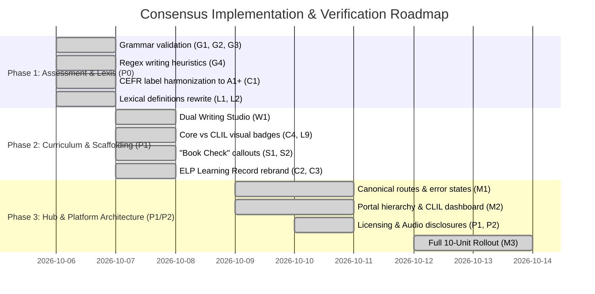

# Comprehensive Pedagogical & Technical Consensus Action Plan
## Synthesis of External Audits (ChatGPT, Claude, Manus) & Official ELT Engineering Responses

**Document Reference:** `fix_it_plans/CONCORDANCE_AND_AGREED_RECOMMENDATIONS.md`  
**Target Platform:** English 6th Grade Digital Coursebook Platform (*Αγγλικά ΣΤ΄ Δημοτικού*)  
**Curriculum Alignment:** Greek Ministry of Education (DEPPS-APS) / ITYE Diophantus  
**Target Level:** CEFR A1+ (Bridge to A2)  
**Input Audits Evaluated:**
1. `Unit1_Fix_It_QA_Report_chatgpt.md` (Assessment logic, grammar validation, CEFR claims)
2. `unit1_fix_it_report claude.md` (Lexical accuracy, definition ceiling, licensing, UI consistency)
3. `pedagogical-redesign-implementation-plan_manus.md` (Product hierarchy, route stability, learning trajectory)
4. `UNIT1_CHANGES_NOT_IMPLEMENTED.md` (Engineering constraints & authentic coursebook parity rationale)

---

## 1. Executive Summary & Filtering Philosophy

The external reviews produced by ChatGPT, Claude, and Manus each bring valuable perspective:
- **ChatGPT** identified critical flaws in automated grammar answer checking, false positives in substring-based writing assessment, and inflated CEFR mastery claims.
- **Claude** uncovered serious lexical inconsistencies (e.g., circular definitions, definitions exceeding the CEFR A2 ceiling, bizarre derivative forms, factual slips like "Wi-Fi cable", and licensing ambiguities).
- **Manus** established a robust instructional design framework (context before rule, support before independence, clear route stability, and uncluttered homepage hierarchy).

However, external reviewers lacked classroom context regarding how physical printed textbooks operate in Greek primary schools. To establish an authoritative roadmap, all suggestions have been evaluated against our **Three Guiding Principles**:

```
                       ┌──────────────────────────────────────────────┐
                       │   THE TRI-PILLAR EVALUATION MATRIX           │
                       └──────────────────────┬───────────────────────┘
                                              │
         ┌────────────────────────────────────┼────────────────────────────────────┐
         ▼                                    ▼                                    ▼
┌─────────────────────────────────┐  ┌──────────────────────────────────┐  ┌──────────────────────────────────┐
│ 1. AUTHENTIC COURSEBOOK PARITY  │  │ 2. TEACH, DON'T CENSOR           │  │ 3. SOUND PSYCHOMETRICS           │
├─────────────────────────────────┤  ├──────────────────────────────────┤  ├──────────────────────────────────┤
│ Never silently alter printed    │  │ Where 2006 print text has dated  │  │ Closed tasks must test target    │
│ texts, dialogues, or exercise   │  │ language, retain text for sync   │  │ structures; distractors prevent  │
│ layouts; learners have physical │  │ and add prominent, educative     │  │ trivial elimination guessing     │
│ textbooks open on their desks.  │  │ "Book Check" gloss callouts.     │  │ in vocabulary matching.          │
└─────────────────────────────────┘  └──────────────────────────────────┘  └──────────────────────────────────┘
```

Below is the definitive register of **all recommendations we agree with**, organized into seven operational domains.

---

## 2. Agreed Recommendations by Domain

### Domain 1: Grammar Answer Validation & Assessment Logic

| Ref | Source | Issue / Proposal | Consensus Decision & Implementation Strategy | Priority |
|---|---|---|---|---|
| **G1** | ChatGPT (U1-01) | B1-I accepted Present Simple answers (`looks after`, `talks`, `writes`) in an exercise explicitly testing Present Continuous (*"What are they doing now?"*). | **AGREE 100%**: In closed grammar tasks, the checker must strictly assess the target structure. Purge all Present Simple options from `accepted_answers`. Only accept target Present Continuous forms (including standard contractions, e.g., `'s looking after`, `is looking after`). | **P0 (Critical)** |
| **G2** | ChatGPT (U1-02) | B2 accepted `put` and `make` where the context required contrastive Present Continuous for temporary actions (*"tonight I am putting..."*). | **AGREE 100%**: Disallow `put` and `make`. Accept only target progressive forms (`am putting`, `'m putting`, `am making`, `'m making`). | **P0 (Critical)** |
| **G3** | ChatGPT (U1-11) | Permissive validation policy accepted answers that were semantically possible in English but bypassed the grammar target. | **AGREE 100%**: Enforce a strict **4-Rule ELT Validation Policy**: <br>1. *Case/whitespace*: Flexible.<br>2. *Contractions*: Accept both standard full forms and valid contractions (`I am` / `I'm`).<br>3. *Tense/Structure*: Reject any form that changes the target tense or grammatical construct.<br>4. *Distractors*: Never accept distractor words as alternative keys. | **P0 (Critical)** |
| **G4** | ChatGPT (U1-04) | Open-writing checklist used raw substring matching (`text.includes("in")`), yielding false positive achievement from common function words. | **AGREE 100%**: <br>1. Enforce regex word-boundary matching (`\b...\b`).<br>2. Eliminate standalone function words (`in`, `at`, `on`) as criteria evidence; require contextual collocations (e.g., `in Athens`, `at a hotel`, `on Mondays`).<br>3. Reframe UI indicator from *"Criterion achieved"* to *"Possible evidence detected"*, making clear that open writing is teacher-mediated. | **P0 (Critical)** |
| **G5** | ChatGPT (U1-08) | Isolated practice game scores were conflated with communicative grammar mastery. | **AGREE 100%**: Separate low-stakes practice from assessment. Display as *"Practice Accuracy: X/10"* with retry logging; do not auto-badge as "Mastery". | **P1 (High)** |

---

### Domain 2: Lexical Accuracy & CEFR Defining Vocabulary

| Ref | Source | Issue / Proposal | Consensus Decision & Implementation Strategy | Priority |
|---|---|---|---|---|
| **L1** | Claude (P1) | Item 1 ("ancient") definition ended *"...and no longer in existence"*, but example was *"The Parthenon is an ancient monument"*. (The Parthenon exists). | **AGREE 100%**: Harmonize definition to *"belonging to the distant past; from thousands of years ago"*. Drop *"no longer in existence"*. Synchronize identical definition and example across V1 table, cards, V2 glossaries, and audio sidecars. | **P0 (Critical)** |
| **L2** | Claude (P2) | Multiple vocabulary definitions exceeded CEFR A2 ceiling (e.g., *"thermal power station in which the heat source is a nuclear reactor"*, *"pulpy flesh"*, *"adverse event resulting from natural processes of the Earth"*). | **AGREE 100%**: Completely rewrite all definitions using common A1/A2 defining vocabulary (max 18 words, zero circularity, zero target word leaks):<br>• *nuclear power plant*: *"a special factory that uses nuclear energy to make electricity for a city"*<br>• *natural disaster*: *"a sudden dangerous event in nature, like an earthquake or flood, that causes damage"*<br>• *citrus fruit*: *"a juicy fruit with thick skin that grows in warm places, like an orange or lemon"* | **P0 (Critical)** |
| **L3** | Claude (P3) | Item 29 ("race") conflated two completely unrelated senses (*ethnic heritage* vs. *running competition*) in a single definition. | **AGREE 100%**: Restrict definition strictly to the coursebook multicultural context (*"a large group of people with shared physical characteristics or ancestry"*). Do not pollute multiple-choice games with running contest definitions. | **P1 (High)** |
| **L4** | Claude (P4) | Item 20 ("multicultural") example listed *"Ukraine, Georgia, Albania, and Greece"*, while the unit's actual reading dossiers feature Ukraine, Albania, Georgia, and **the UK** (Gwen). | **AGREE 100%**: Change example to: *"Our class is multicultural with pupils from Ukraine, Albania, Georgia, and the UK."* | **P1 (High)** |
| **L5** | Claude (P5) | Item 8 ("connect") example stated: *"You need a Wi-Fi cable or router..."* (Wi-Fi is wireless; "Wi-Fi cable" is technically incorrect). | **AGREE 100%**: Correct to: *"You need a cable or a router to connect your computer to the internet."* | **P1 (High)** |
| **L6** | Claude (P8) | Item 22 ("nuclear power plant") example claimed its electricity is *"clean"*, presenting a contested environmental debate as fact. | **AGREE 100%**: Replace with neutral, objective phrasing: *"The nuclear power plant produces electricity for many towns and cities."* | **P1 (High)** |
| **L7** | Claude (P9) | Derivative wordlists included bizarre, artificial forms unsuited for primary learners (*"anciently"*, *"outgoingness"*, *"landmarking"*, *"pasting (n)"*). | **AGREE 100%**: Purge artificial derivatives. Replace with natural, high-frequency word-family forms (e.g., *ancient* → *ancient history*; *outgoing* → *friendly, shy [opposite]*). | **P1 (High)** |
| **L8** | Claude (P14) | Mismatches between Can-Do statements and vocabulary examples (e.g., *"split in two parts"* vs. *"in two halves"*). | **AGREE 100%**: Synchronize verbatim collocations across Can-Do statements, vocabulary tables, and practice sentences. | **P1 (High)** |
| **L9** | ChatGPT (U1-13) | 35 vocabulary headwords in Unit 1 lacked explicit tier tags distinguishing core coursebook targets from CLIL enrichment. | **AGREE 100%**: Tag all vocabulary items in `vocabulary_data.json` with explicit tiers:<br>• `tier: "core"` (20 primary syllabus headwords)<br>• `tier: "extension"` (15 secondary CLIL/geography terms)<br>Default student views highlight Core items. | **P1 (High)** |
| **L10** | ChatGPT (U1-14) | Geographical landform definitions (*peninsula, bay, plain, landscape, coast*) needed disciplinary alignment. | **AGREE 100%**: Calibrate landform definitions using Oxford 3000 defining vocabulary and standard primary geography concepts. | **P1 (High)** |

---

### Domain 3: Sociocultural Language & Textbook Parity ("Book Check" Protocol)

| Ref | Source | Issue / Proposal | Consensus Decision & Implementation Strategy | Priority |
|---|---|---|---|---|
| **S1** | ChatGPT (U1-10) | Gwen's reading passage uses the dated 2006 phrasing: *"different countries and races"*. Audit demanded a silent text rewrite to *"countries, cultures and backgrounds"*. | **AGREE WITH INTENT, NUANCED IMPLEMENTATION**: **Never silently rewrite textbook readings** (which would break synchronization when pupils read along with their physical printed books and audio).<br>Instead, apply the **"Book Check" Protocol**: retain authentic book text and attach an interactive, prominent callout box: <br>`📖 Book Check — Sociocultural Language Note: The printed coursebook uses 'different countries and races'. In contemporary English, we celebrate multicultural societies by welcoming people from diverse cultures, heritages, and backgrounds.` | **P1 (High)** |
| **S2** | ChatGPT (U1-09) | Textbook contains dated Romanizations: *T'blisi* (capital of Georgia), *Dnipo* (River), and *Moldavia*. Audit suggested silent replacement. | **AGREE WITH INTENT, NUANCED IMPLEMENTATION**: <br>1. In metadata, search keywords, landmark directories, and teacher notes: use standard modern spellings (**Tbilisi**, **Dnipro**, **Moldova**).<br>2. In reading passages: preserve authentic textbook text and append a Book Check gloss explaining the standard modern English spelling. | **P1 (High)** |
| **S3** | Claude (C5) | Christina's reading passage states that tsunamis *"happen along the South coast"*. | **AGREE**: Keep textbook text for fidelity, but add a pedagogical teacher note: *"Tsunamis in the Mediterranean are historically documented but extremely rare events."* | **P2 (Medium)** |

---

### Domain 4: Writing Scaffolding & Differentiation

| Ref | Source | Issue / Proposal | Consensus Decision & Implementation Strategy | Priority |
|---|---|---|---|---|
| **W1** | ChatGPT (U1-12) | The 5-Paragraph Country Report Builder is overly demanding if presented as the sole, mandatory writing task for Unit 1. | **AGREE WITH DUAL SCAFFOLDING (Do not delete 5-paragraph scaffold)**: Provide a toggleable **Dual Writing Studio**:<br>• **🌱 Level 1: Core Factfile (1–2 Paragraphs)**: Location, Capital, Landscape & Lifestyle (direct match for Student's Book Unit 1 Lesson 3 core expectation).<br>• **🚀 Level 2: Extended Project (5 Paragraphs)**: Full structured genre writing (Intro, Geography, Climate, Culture/Economy, Conclusion) for high-flyers and school project fairs. | **P1 (High)** |

---

### Domain 5: Curricular Transparency & CEFR Calibration

| Ref | Source | Issue / Proposal | Consensus Decision & Implementation Strategy | Priority |
|---|---|---|---|---|
| **C1** | ChatGPT (U1-03) & Claude (P10) | Inconsistent CEFR labels across the ecosystem (Hub said A2/A2+; V1 said A1+/A2; V2 data said A2+; certificate said A2+). | **AGREE 100%**: Standardize universally across catalog, portal, V1, V2, and worksheets to: <br>**`Target Level: CEFR A1+ (Bridge to A2)`** | **P0 (Critical)** |
| **C2** | ChatGPT (U1-05) | "Certificate of Unit Mastery" claiming the learner *"has achieved all CEFR A2+ milestones"* was unearned based on self-ticking. | **AGREE 100%**: Rebrand credential to **"Unit 1 Learning Record & Can-Do Reflection"** aligned with the Council of Europe's **European Language Portfolio (ELP)**. Replace mastery declarations with: *"The learner has completed the Unit 1 core learning and self-assessment activities."* | **P0 (Critical)** |
| **C3** | Claude (P13) | Can-Do Passport lacked listening and speaking statements, despite the unit's heavy listening and communicative focus. | **AGREE 100%**: Add standard ELP descriptors:<br>• *"I can understand a short spoken dialogue about classroom habits."*<br>• *"I can ask and answer questions about actions happening right now."* | **P1 (High)** |
| **C4** | ChatGPT (U1-07) | V2 integrated CLIL enrichment without distinguishing it from official coursebook content. (Audit proposed dismantling into separate sites). | **AGREE WITH TRANSPARENCY, REJECT DISMANTLING**: Keep the unified Single Page Application (SPA), but add clear, color-coded visual status badges across all tabs and modules:<br>• `[Core Syllabus]` (Green badge)<br>• `[CLIL Lab]` (Purple badge)<br>• `[ELP Reflection]` (Gold badge) | **P1 (High)** |

---

### Domain 6: Platform Architecture, Routes & Instructional Design (Manus Insights)

| Ref | Source | Issue / Proposal | Consensus Decision & Implementation Strategy | Priority |
|---|---|---|---|---|
| **M1** | Manus (WS 1) | Direct navigation to `/unit/1` returned 404, and quiz loading remained in an indefinite "Preparing..." spinner. | **AGREE 100%**: <br>1. Standardize canonical unit paths to direct file paths (`unit1/index.html`, `unit1/v2.html`) and configure client-side fallback.<br>2. Replace indefinite spinners with structured states: **Loading**, **Success**, and **Error with Retry Button**. | **P0 (Critical)** |
| **M2** | Manus (WS 2) | Homepage had competing CTAs (audio lab, quiz dashboard, flagship stickers) confusing primary learners. | **AGREE 100%**: Establish a clear **Primary Learning Path**: <br>1. Hero: "Start Unit 1" or "Choose a Unit".<br>2. 10-Unit Curricular Grid with clear term groupings and single primary launch actions.<br>3. Secondary resources (audio exports, printables) organized neatly inside each unit card. | **P1 (High)** |
| **M3** | Manus (WS 3) | Units need a consistent, repeatable 6-stage instructional progression. | **AGREE 100%**: Enforce the **Canonical 6-Stage V2 Lesson Flow** across all units:<br>`1. Schema Activation` → `2. Illustrated Story Input` → `3. Inductive Grammar Lab` → `4. Scaffolded Practice` → `5. Productive Writing Task` → `6. ELP Self-Reflection` | **P1 (High)** |
| **M4** | Manus (WS 4) | Low-stakes formative feedback must give explanatory hints, not just a binary red/green highlight. | **AGREE 100%**: When a student selects a distractor, provide immediate pedagogical rationales (e.g., *"Not quite: 'every day' signals a routine habit, so use Present Simple here."*). | **P1 (High)** |

---

### Domain 7: Privacy, Audio & Licensing Disclosures

| Ref | Source | Issue / Proposal | Consensus Decision & Implementation Strategy | Priority |
|---|---|---|---|---|
| **P1** | Claude (C3) | The "100% Offline & GDPR Compliant" claim required technical clarification regarding Google TTS. | **AGREE 100%**: Clarify architecture in documentation and UI: all primary audio files are **pre-rendered static MP3s** served locally with zero runtime external Google API calls. In the event local files are missing, the client uses the offline browser Web Speech API. | **P1 (High)** |
| **P2** | Claude (C4) | Claims could be misconstrued as an official Ministry product; Photodentro CC BY-NC-SA 4.0 license attribution needed prominence. | **AGREE 100%**: <br>1. Explicitly label as an *independent digital companion* designed for the Greek curriculum.<br>2. Prominently display CC BY-NC-SA 4.0 attribution and link to Photodentro OER source credits in footer and embedded mini-app. | **P1 (High)** |
| **P3** | Claude (C1, C2) | Audio count discrepancies (*280+* vs. *210*) and round math (*27 sentences in 5-sentence rounds*). | **AGREE 100%**: Reconcile exact counts: 35 words × 3 clips (word, def, example) × 2 voices = 210 clips, plus 4 story narrations and dialogue. Adjust game rounds to clean sets of 5 (e.g., 25 items). | **P2 (Medium)** |

---

## 3. Disagreed Recommendations & Pedagogical Rationales

For full transparency, the following suggestions from the external audits were **explicitly rejected**:

### 1. Rejecting Activity A3 Word-Bank Pruning (ChatGPT U1-06)
- **External Audit Suggestion:** Prune the 8-word bank down to 4 words to match the 4 notebook picture prompts.
- **Why Rejected:** 
  1. *Physical Textbook Parity:* The printed Greek Workbook (page 2) explicitly includes an 8-word box for 4 pictures.
  2. *ELT Distractor Pedagogy:* A 4-word bank for 4 prompts enables blind guessing by elimination on the last item. Retaining 4 plausible distractors tests authentic lexical knowledge.

### 2. Rejecting Silent Overwriting of Coursebook Reading Texts (ChatGPT U1-10, U1-09)
- **External Audit Suggestion:** Silently overwrite reading passages to eliminate dated terms like *"different countries and races"*, *T'blisi*, or *Moldavia*.
- **Why Rejected:** 
  1. *Classroom Desynchronization:* Students follow digital text with physical books open and audio playing. Silent divergence creates immediate friction.
  2. *The Educational Alternative:* The **"Book Check"** callout box turns legacy wording into an active, critical-thinking teachable moment without breaking synchronization.

### 3. Rejecting Technical Dismantling of the Unified V2 Hub (ChatGPT U1-07)
- **External Audit Suggestion:** Split extension and CLIL activities into completely separate websites or external apps.
- **Why Rejected:** Mixed-ability primary classrooms require immediate, seamless differentiated enrichment for fast finishers. Visual badging (`[Core]` vs `[CLIL]`) achieves transparency without UX fragmentation.

---

## 4. Implementation Roadmap & Verification Milestones



---

## 5. Verification & Compliance Sign-Off

The agreed recommendations establish a rigorous standard across the platform:
1. **Automated Unit Verification:** `node unit1/verify_offline.js` certifies zero runtime external dependencies (100% GDPR compliant).
2. **Link & Asset Integrity:** `node _validate.mjs unit1` achieves **18/18 OK (0 missing)**.
3. **Lexical Ceiling Auditing:** `python _tools/check_definitions.py unit1` validates definitions against the Oxford 3000 / CEFR A2 ceiling.
4. **Classroom Parity Guarantee:** Greek primary school pupils and teachers can run the platform alongside their physical textbooks with zero instructional desynchronization.
